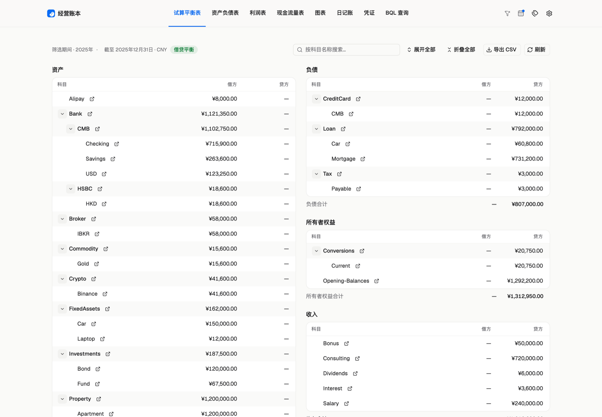
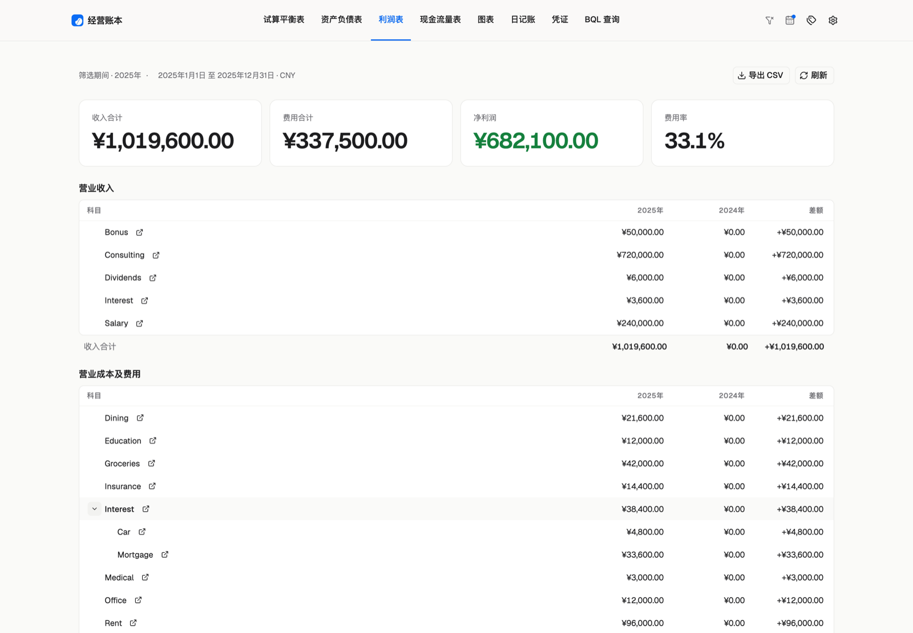
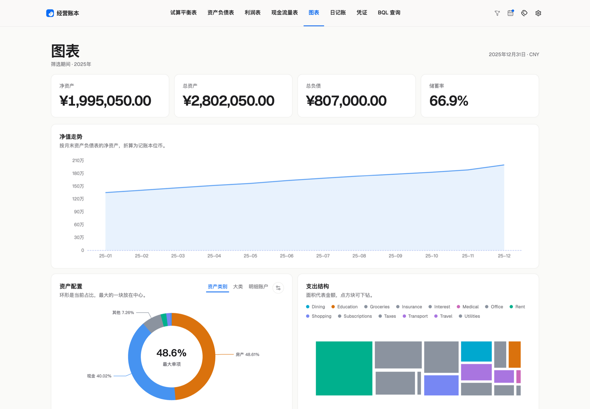

# BeanDesk · Business Ledger (Secondary Development)

[](https://github.com/SuperDaniel-cn/BeanDesk)
[](./LICENSE)

> A local-first Beancount desktop workbench for individuals, independent creators, and one-person companies.

[简体中文](README.md) | English

## Origin and relationship

This project is a derivative of [SuperDaniel-cn/BeanDesk](https://github.com/SuperDaniel-cn/BeanDesk).

- Original author: **SuperDaniel-cn**
- Original license: **AGPL-3.0**
- This repository is not an official release by the original author and does not represent them
- The original copyright, design notes, and handbook chapters are retained; changes in this branch are also released under **AGPL-3.0**
- See [SECONDARY-DEVELOPMENT.md](./SECONDARY-DEVELOPMENT.md) for the change scope

## What this branch changes

The local ledger, Fava reports, documents, query console, and backup workflow from the original project remain intact. This branch focuses on three areas: **Windows support, report reading experience, and interface legibility**.



### Windows x64 support

- macOS and Windows from one codebase
- NSIS installer with tray, single-instance behavior, and no-console launch
- Drive-letter, UNC-path, and Windows child-process handling
- Windows CI builds the installer and verifies a silent install with the bundled engine

### Report reading experience

- Two-column balance sheet with asset and liability composition in the right rail
- KPI summaries on the income statement and cash flow statement
- Chinese, full-pinyin, and initials search in the trial balance; expand/collapse
- Consistent card and summary treatment across the four statements
- Improved prior-period comparison and period switching



### Charts and portfolio

- Charts page covering net worth, cash flow, savings rate, composition, and payees
- Asset allocation by asset class, group, or account
- Portfolio targets with quick selection
- Stable category colors, plus empty, failure, and unconverted-currency states
- Keyboard-readable chart details



### Periods, amounts, and empty states

- Year, quarter, month, and custom date ranges
- Select first, then apply; one-click clear
- Separate true zero, no data, and missing FX instead of treating failures as zero
- Crypto precision by unit
- Consistent amount formatting between the UI and CSV export

### Legibility and accessibility

- Warm canvas and high-chroma data colors instead of muddy tones
- Comfortable and compact density modes
- 70%–250% interface zoom with shortcuts
- Focus trapping in the period dialog, reduced motion, and chart contrast fixes
- Toggle between localized account names and raw account paths

### Brand, docs, and engineering

- Bean-and-ledger app icon, tray icon, and About page
- Original author and upstream repository placed prominently in the handbook
- Bilingual handbook and secondary-development notes
- 196 web tests and 153 Rust tests
- macOS and Windows CI; lazy-loaded report and settings pages

## Retained from the original project

The local Beancount / Fava workflow, document preview, BQL query and CSV export, local MCP, Git snapshots, and restic encrypted backups come from the original project and are retained. They are not claimed as new work here.

This branch does not add cloud sync or online collaboration; the ledger remains a local Beancount file.

## Who it is for

- People who want their ledger to stay on their own machine without a cloud account
- People using Beancount for personal or one-person-company books
- People who want more readable reports, charts, and period comparisons than plain text

## Quick start

The current development version is **0.3.0**. Official installers will be published on this repository's Releases page.

From source:

```bash
git clone https://github.com/moc2216/BeanDesk.git
cd BeanDesk
make install
make desktop
```

Checks:

```bash
make test
```

## Docs and license

- Handbook: [docs/content/docs](./docs/content/docs)
- Secondary development: [SECONDARY-DEVELOPMENT.md](./SECONDARY-DEVELOPMENT.md)
- Notices: [NOTICE](./NOTICE)
- License: [AGPL-3.0](./LICENSE)
