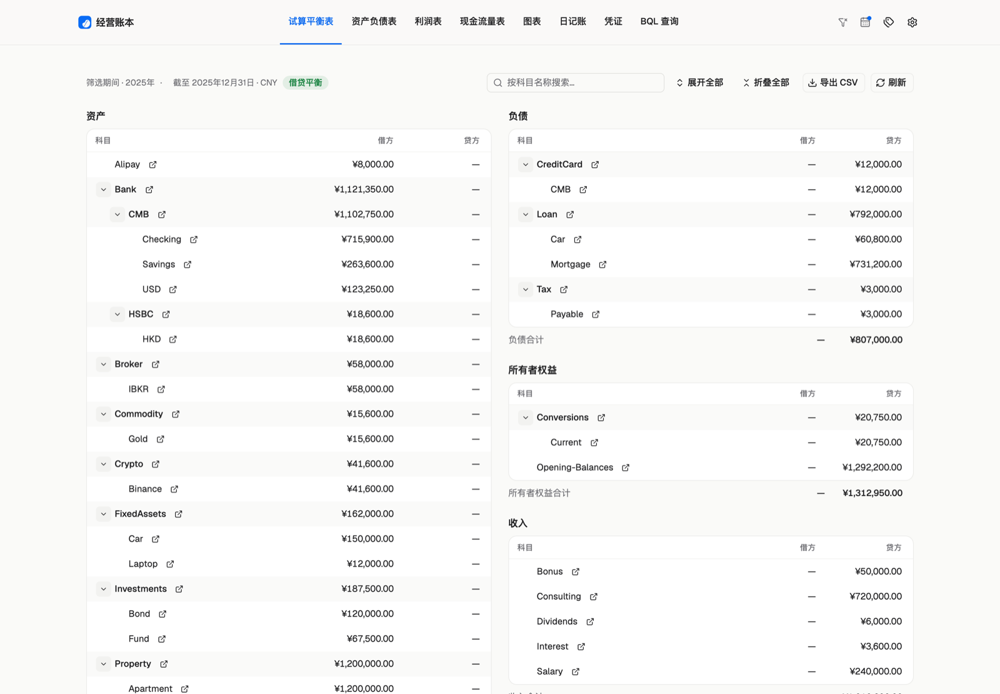
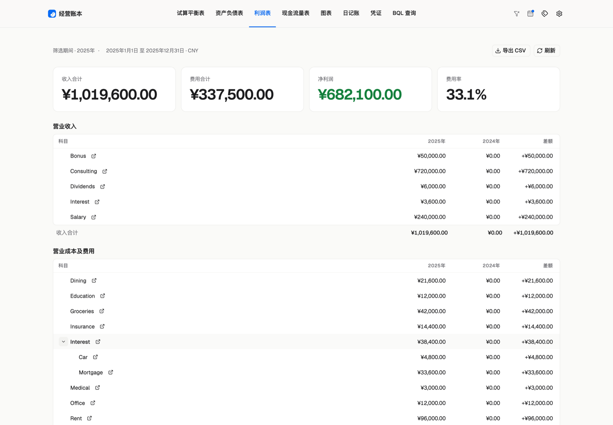
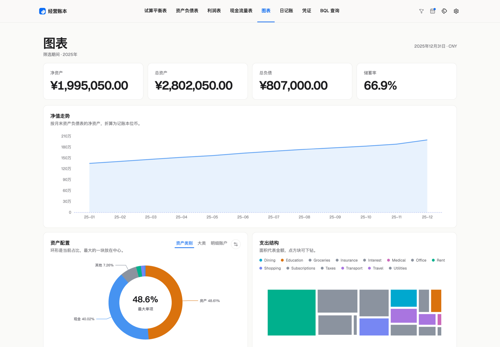

# BeanDesk · 经营账本（二次开发版）

[](https://github.com/SuperDaniel-cn/BeanDesk)
[](./LICENSE)

> 本地优先的 Beancount 桌面工作台，面向个人、独立创作者与一人公司。

简体中文 | [English](README.en.md)

## 来源与关系

本项目基于 [SuperDaniel-cn/BeanDesk](https://github.com/SuperDaniel-cn/BeanDesk) 二次开发。

- 原作者：**SuperDaniel-cn**
- 原项目许可证：**AGPL-3.0**
- 本仓库不是原作者官方版本，也不代表原作者
- 原项目的版权、设计说明与手册章节保留；本分支的修改同样以 **AGPL-3.0** 发布
- 具体改动范围见 [SECONDARY-DEVELOPMENT.md](./SECONDARY-DEVELOPMENT.md)

## 这个分支主要做了什么

原项目的本地账本、Fava 报表、凭证、查询和备份能力保持不变。本分支集中补齐三件事：**Windows 支持、报表阅读体验、界面可读性**。



### Windows x64 支持

- macOS 与 Windows 双平台
- Windows 使用 NSIS 安装包，支持托盘、单实例、无控制台启动
- 处理盘符、UNC 路径和 Windows 子进程生命周期
- CI 在 Windows 上构建安装包，并做静默安装与内置引擎校验

### 报表阅读体验

- 资产负债表改为两栏布局，右栏集中展示资产构成与负债构成
- 利润表、现金流量表增加 KPI 摘要
- 试算平衡表支持中文、全拼、首字母搜索，以及展开/收起
- 四张报表统一为一致的卡片与摘要样式
- 完善上期对比和期间切换后的数据表现



### 图表与投资组合

- 新增图表页：净值、现金流、储蓄率、构成、收款方
- 资产配置支持“资产类别 / 分组 / 账户”三种维度
- 投资组合支持目标占比与快速选择
- 分类颜色保持稳定，补充空态、失败态、未折算汇率提示
- 图表明细支持键盘读取



### 期间、金额与空态

- 年、季度、月度与自定义日期区间
- 先选期间、再应用；支持一键清除
- 区分“真零”“无数据”“缺汇率”，不把失败当成 0
- 加密货币按单位保留精度
- 金额展示与 CSV 导出保持一致

### 可读性与无障碍

- 暖白画布、高彩度数据色，避免发灰、发土
- 舒适 / 紧凑两档界面密度
- 支持 70%–250% 显示缩放，含快捷键
- 期间弹窗焦点锁定、减少动效、图表对比度修正
- 中文账户名与原始账户路径可切换显示

### 品牌、文档与工程

- “豆与账线”应用图标、托盘图标与关于页
- 原作者与原始项目地址放在手册最显眼的位置
- 中英文手册与二次开发说明
- Web 196 项、Rust 153 项单元测试
- macOS / Windows CI；报表页、设置页按需加载

## 原项目已有、本分支保留

本地 Beancount / Fava 工作流、凭证预览、BQL 查询与 CSV 导出、本地 MCP、Git 快照与 restic 加密备份等能力，均来自原项目并继续保留，不是本次新增。

本分支不做云同步、不做在线协作，账本仍然是本地 Beancount 文件。

## 适合谁

- 希望账本数据留在本机、不依赖云端账号的人
- 使用 Beancount 管理个人或一人公司账目的人
- 需要比纯文本账本更直观的报表、图表与期间对比的人

## 快速开始

当前开发版版本为 **0.3.0**。正式安装包将在本仓库的 Releases 页面提供。

源码运行：

```bash
git clone https://github.com/moc2216/BeanDesk.git
cd BeanDesk
make install
make desktop
```

运行检查：

```bash
make test
```

## 文档与许可

- 使用手册：[docs/content/docs](./docs/content/docs)
- 二次开发说明：[SECONDARY-DEVELOPMENT.md](./SECONDARY-DEVELOPMENT.md)
- 版权与归属：[NOTICE](./NOTICE)
- 许可证：[AGPL-3.0](./LICENSE)
